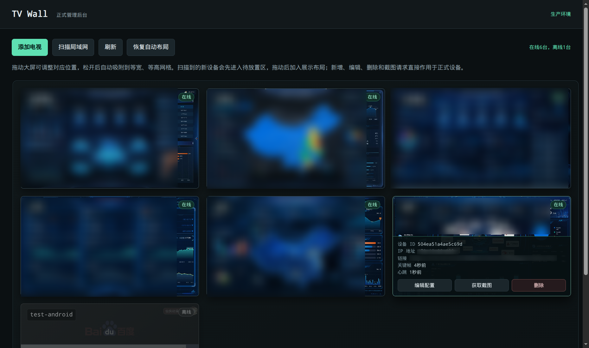

# TV Wall

一个用于内网电视墙的管理端和 Android 展示客户端。管理端负责设备注册、展示网址配置、心跳/在线状态、关键帧和即时截图；Android 客户端使用 WebView 打开展示网址，并定时把当前画面上传到管理端。

项目适合部署在可信内网中。管理接口目前没有内置用户登录和权限系统，公开到互联网前请先在反向代理或网关层增加认证、TLS 和访问控制。

## 管理台预览


## 功能概览

- Go 管理服务，内嵌单页管理后台，不需要单独部署前端。
- Android 8.0（API 26）及以上客户端，固定横屏展示网页。
- 客户端自动上报心跳和自身 IP；管理端根据心跳显示在线/离线状态。
- 管理端保存每台设备最新关键帧，支持下发即时截图请求。
- 电视墙布局支持拖拽、网格吸附、待放置区和四屏自适应布局。
- 可手动扫描局域网中的客户端发现服务（TCP `17301`），也可以直接按客户端 IP 添加。
- 设备凭据由服务端按设备生成，客户端首次注册后保存在 Android 应用私有存储中。

## 目录结构

```text
server/                  Go 服务和内嵌管理页面
  main.go
  main_test.go
  web/index.html
android-client/          Android 客户端工程
deploy/tvwall.service    systemd 示例服务
Dockerfile               Docker 多阶段构建文件
docker-compose.yml       Docker Compose 部署配置
```

## 服务端本地运行

需要 Go 1.23 或兼容版本：

```bash
cd server
go test ./...
go build -buildvcs=false -trimpath -o ../tvwall-server .
cd ..

TVWALL_DATA=./data \
TVWALL_LISTEN_ADDR=:8088 \
./tvwall-server
```

打开 `http://<服务器地址>:8088/` 进入管理后台。`TVWALL_DATA` 默认是当前目录下的 `data`，其中包含设备配置和最新截图；请勿把这个目录提交到公开仓库。

可用环境变量：

| 变量 | 默认值 | 说明 |
| --- | --- | --- |
| `TVWALL_DATA` | `./data` | 设备配置和截图的持久化目录 |
| `TVWALL_LISTEN_ADDR` | `:8088` | HTTP 监听地址和端口 |

## Docker 部署

Docker 镜像以非 root 用户运行，设备数据通过 `./data` 挂载持久化：

```bash
docker compose up -d --build
docker compose ps
```

默认访问端口为 `8088`。如需修改宿主机端口，只改变左侧端口映射：

```bash
TVWALL_PORT=18088 docker compose up -d --build
```

升级代码时再次执行 `docker compose up -d --build` 即可。不要删除 `data` 目录，否则会丢失设备注册信息和截图。

## Android 客户端打包

### 环境要求

- Android SDK 34
- JDK 17
- Android Gradle Plugin 8.5.2 对应的 Gradle 版本（推荐 Gradle 8.7）
- Android 设备 API 26 或更高版本

### 必须配置服务端 URL

客户端不会在安装后弹窗配置服务端地址，服务端 URL 会在 APK **构建时**写入 `BuildConfig.SERVER_URL`。构建时必须把它替换成安卓设备/安卓电视能够访问的管理端地址，例如：

```bash
cd android-client
gradle :app:assembleDebug \
  -PtvwallServerUrl=http://192.0.2.10:8088 \
  --no-daemon
```

也可以使用环境变量：

```bash
TVWALL_SERVER_URL=http://192.0.2.10:8088 \
  gradle :app:assembleDebug --no-daemon
```

`-PtvwallServerUrl` 优先于 `TVWALL_SERVER_URL`。工程内置的 `192.0.2.1` 是文档保留地址，只用于避免把真实内网地址提交到仓库，不能用于实际连接。服务端 URL 应包含协议和端口，例如 `http://<管理端主机>:8088`，不要填写客户端自己的 IP。

Debug APK 输出位置：

```text
android-client/app/build/outputs/apk/debug/app-debug.apk
```

安装到已开启 USB 调试的安卓设备/安卓电视：

```bash
adb install -r android-client/app/build/outputs/apk/debug/app-debug.apk
adb shell monkey -p com.tvwall.client 1
```

Release 构建命令如下，但当前工程没有配置签名信息，需要自行接入签名配置后才能发布到正式设备：

```bash
cd android-client
gradle :app:assembleRelease \
  -PtvwallServerUrl=https://<管理端域名> \
  --no-daemon
```

客户端使用 HTTP 时，Manifest 允许明文流量，适合隔离内网测试；生产环境建议通过 HTTPS 反向代理提供服务，并根据部署方式关闭明文流量。

## 客户端首次注册

1. 先让安卓设备/安卓电视安装并启动客户端，客户端会使用 Android ID 向管理端注册。
2. 在管理后台通过“添加电视”填写客户端 IP，或者手动执行局域网扫描。
3. 客户端下一次心跳成功后会绑定设备、保存服务端返回的 token，并开始接收展示网址配置。
4. 在管理后台编辑设备，填写展示网址；客户端会自动加载该网址并按配置上传关键帧。

客户端会自动从请求来源更新 IP，通常不需要在客户端配置自己的 IP。token 存储在 Android 应用私有存储中；清除应用数据或卸载重装会删除本地 token，需要重新完成注册。对于从未成功心跳的预登记设备，服务端允许从登记 IP 重新领取凭据；已正常使用的设备仍会校验原 token。

局域网扫描依赖客户端的 TCP `17301` 发现服务。扫描范围应填写实际网段，扫描结果会被管理端加入设备列表；请只在受信任的内网使用扫描功能。

## 数据和安全

- `data/`、APK、Gradle 缓存、`local.properties` 和本地日志都不应提交到 Git。
- `devices.json` 包含设备 token，截图目录可能包含业务画面，应按敏感数据保护。
- 管理 API 没有内置账号密码；不要直接映射到公网。需要公网访问时，请增加反向代理认证、TLS、来源限制和审计。
- Android 构建参数中的服务端 URL 不是密码，但可能包含内部域名；公开仓库只使用示例地址，实际地址通过命令行参数或环境变量注入。
- 公开发布前请检查 Git 历史、构建产物、压缩包和 CI 日志，避免已经提交的密钥或内网地址残留。

## systemd 部署示例

`deploy/tvwall.service` 使用通用路径 `/opt/tvwall` 和 `/var/lib/tvwall`，部署前按实际目录调整：

```bash
sudo useradd --system --home /var/lib/tvwall --shell /usr/sbin/nologin tvwall || true
sudo install -d -o tvwall -g tvwall /var/lib/tvwall
sudo install -d /opt/tvwall
sudo install -m 0755 tvwall-server /opt/tvwall/tvwall-server
sudo install -m 0644 deploy/tvwall.service /etc/systemd/system/tvwall.service
sudo systemctl daemon-reload
sudo systemctl enable --now tvwall
sudo systemctl status tvwall
```

## 许可证

本项目采用 [MIT License](LICENSE) 开源。你可以自由使用、复制、修改、合并、发布、分发、再许可和销售本项目，但需要在副本或重要部分中保留原版权声明和许可证文本。

项目依赖的第三方库和 Android 组件可能采用各自的许可证，请同时遵守它们的许可条款。

